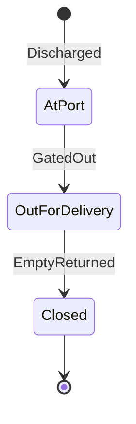
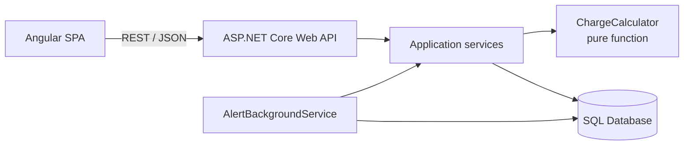
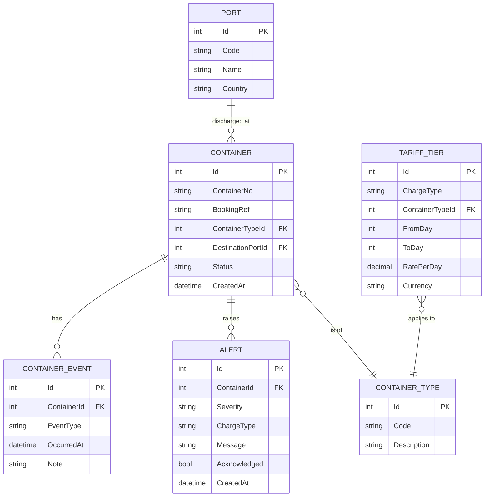

# D&D Tracker: Container Demurrage & Detention Dashboard

> A small full-stack app that shows shippers how many free days each container has left, what charges have accrued, and what they will pay if the container is cleared on a chosen date, with automatic alerts before charges begin.

**Stack:** ASP.NET Core 10 Web API · EF Core · SQL Server (or PostgreSQL/SQLite) · Angular 20 (standalone components) · Angular Material · xUnit

---

## 1. Problem Statement

In container shipping, customers are often surprised by invoices for:

- **Demurrage**: a loaded container stays at the destination port longer than the free days allow.
- **Detention**: a container is taken out of the terminal and the empty is not returned to the depot within the free days.

Customers usually find out only when the invoice arrives. This project makes the countdown and the cost visible **before** charges start, and lets users simulate "what if I clear it on date X?".

> Note: This is an independent MVP built to explore the problem. It is not a copy of any company's internal system.

---

## 2. Scope

### In scope (MVP)

- Container list with computed free days remaining, days elapsed, and accrued charge
- Container detail page with event timeline and per-tier charge breakdown
- Record events: Discharged, Gated Out, Empty Returned (with sequence validation)
- Projection: "charge if cleared on date X"
- Background job that raises Warning and Critical alerts
- Dashboard summary: at-risk count, accruing count, total accrued
- Seed data covering safe, at-risk, accruing, and closed containers

### Out of scope (next steps)

- Authentication and role-based access
- Real terminal or carrier data integration
- Email / WhatsApp notifications
- Per-customer negotiated free days
- Weekend/holiday exclusions and per-port time zones
- Multi-currency conversion

---

## 3. Domain Rules

| Rule | Definition |
|---|---|
| Demurrage clock | Starts at **Discharged** date, stops at **Gated Out** date |
| Detention clock | Starts at **Gated Out** date, stops at **Empty Returned** date |
| Day counting | Calendar days. The start date counts as **day 1** |
| Open clock | If no end event exists, the clock runs to the "as of" date |
| Tariffs | Tiered per day, per container type, per charge type |
| Free time | Represented as tier(s) with `RatePerDay = 0` |

### Example tariff: 40' HC Demurrage (USD)

| Days | Rate per day |
|---|---|
| 1 to 5 | 0 (free) |
| 6 to 10 | 25 |
| 11 and above | 50 |

**Worked example:** 13 days elapsed. Days 1-5 = 0, days 6-10 = 5 × 25 = 125, days 11-13 = 3 × 50 = 150. **Total = 275 USD.**

### Container lifecycle



- `Discharged` starts the demurrage clock.
- `GatedOut` stops demurrage and starts the detention clock.
- `EmptyReturned` stops detention and closes the container.

---

## 4. Architecture



**Key design decisions**

1. **Charges are computed at read time**, not stored. Events and tariffs are the source of truth, so there is no stale data and no recalculation job.
2. **`ChargeCalculator` is a pure static function** with no DB or clock access. `asOf` is passed in, which makes it fully unit-testable and gives the projection feature for free.
3. **Background job uses `IServiceScopeFactory`** to create a scope per run, because `DbContext` is scoped and hosted services are singletons.
4. **Duplicate-alert prevention**: one unacknowledged alert per (container, severity).
5. **Event sequence validation** lives in the service layer and returns `400` with a clear message.

---

## 5. Database Schema

### 5.1 ER diagram



### 5.2 Table definitions (SQL Server flavour)

```sql
CREATE TABLE Port (
    Id        INT IDENTITY PRIMARY KEY,
    Code      NVARCHAR(10)  NOT NULL UNIQUE,   -- e.g. INNSA, RUNVS
    Name      NVARCHAR(100) NOT NULL,
    Country   NVARCHAR(60)  NOT NULL
);

CREATE TABLE ContainerType (
    Id          INT IDENTITY PRIMARY KEY,
    Code        NVARCHAR(10)  NOT NULL UNIQUE,  -- 20GP, 40GP, 40HC, ISOTANK
    Description NVARCHAR(100) NOT NULL
);

CREATE TABLE Container (
    Id                INT IDENTITY PRIMARY KEY,
    ContainerNo       NVARCHAR(11)  NOT NULL UNIQUE,  -- ISO 6346, e.g. ECNU1234567
    BookingRef        NVARCHAR(30)  NOT NULL,
    ContainerTypeId   INT NOT NULL REFERENCES ContainerType(Id),
    DestinationPortId INT NOT NULL REFERENCES Port(Id),
    Status            NVARCHAR(20)  NOT NULL,         -- AtPort | OutForDelivery | Closed
    CreatedAt         DATETIME2     NOT NULL DEFAULT SYSUTCDATETIME()
);
CREATE INDEX IX_Container_Status ON Container(Status);

CREATE TABLE ContainerEvent (
    Id          INT IDENTITY PRIMARY KEY,
    ContainerId INT NOT NULL REFERENCES Container(Id) ON DELETE CASCADE,
    EventType   NVARCHAR(20)  NOT NULL,   -- Discharged | GatedOut | EmptyReturned
    OccurredAt  DATETIME2     NOT NULL,
    Note        NVARCHAR(250) NULL,
    CONSTRAINT UQ_ContainerEvent UNIQUE (ContainerId, EventType)  -- one of each per container
);

CREATE TABLE TariffTier (
    Id              INT IDENTITY PRIMARY KEY,
    ChargeType      NVARCHAR(15)  NOT NULL,   -- Demurrage | Detention
    ContainerTypeId INT NOT NULL REFERENCES ContainerType(Id),
    FromDay         INT NOT NULL,
    ToDay           INT NULL,                 -- NULL = open-ended
    RatePerDay      DECIMAL(10,2) NOT NULL,   -- 0 = free time
    Currency        CHAR(3)       NOT NULL DEFAULT 'USD',
    CONSTRAINT CK_Tier_Range CHECK (ToDay IS NULL OR ToDay >= FromDay),
    CONSTRAINT UQ_Tier UNIQUE (ChargeType, ContainerTypeId, FromDay)
);

CREATE TABLE Alert (
    Id           INT IDENTITY PRIMARY KEY,
    ContainerId  INT NOT NULL REFERENCES Container(Id) ON DELETE CASCADE,
    Severity     NVARCHAR(10)  NOT NULL,      -- Warning | Critical
    ChargeType   NVARCHAR(15)  NOT NULL,
    Message      NVARCHAR(300) NOT NULL,
    Acknowledged BIT           NOT NULL DEFAULT 0,
    CreatedAt    DATETIME2     NOT NULL DEFAULT SYSUTCDATETIME()
);
CREATE INDEX IX_Alert_Open ON Alert(Acknowledged, ContainerId, Severity);
```

### 5.3 Why this shape

- **`ContainerEvent` has a unique `(ContainerId, EventType)`**: each milestone happens once, which keeps clock logic trivial. (For a real system with re-gate-outs you would relax this.)
- **`TariffTier` stores free time as a rate of 0**, so there is one concept instead of a separate "free days" column. Free days remaining = the highest `ToDay` among zero-rate tiers minus days elapsed.
- **`Container.Status` is denormalised** for fast filtering. It is updated in the same transaction as the event insert.
- **No charge amount column anywhere.** Charges are derived.

### 5.4 Seed data

- **Ports:** Nhava Sheva (INNSA), Novorossiysk (RUNVS), Singapore (SGSIN), Jebel Ali (AEJEA)
- **Container types:** 20GP, 40GP, 40HC, ISOTANK
- **Tariffs:** demurrage and detention tiers for each type (three tiers each, as in the example above)
- **~15 containers** covering: safe (5+ free days left), at risk (≤2 days), accruing demurrage, accruing detention, and closed

---

## 6. Domain Code

### 6.1 Enums

```csharp
public enum EventType   { Discharged, GatedOut, EmptyReturned }
public enum ChargeType  { Demurrage, Detention }
public enum ContainerStatus { AtPort, OutForDelivery, Closed }
public enum AlertSeverity { Warning, Critical }
```

### 6.2 Charge calculator

```csharp
public record ChargeResult(
    ChargeType ChargeType,
    int DaysElapsed,
    int FreeDaysRemaining,
    decimal Amount,
    string Currency,
    IReadOnlyList<TierBreakdown> Breakdown);

public record TierBreakdown(int FromDay, int? ToDay, int DaysInTier, decimal Rate, decimal Subtotal);

public static class ChargeCalculator
{
    public static ChargeResult Calculate(
        ChargeType type,
        DateTime start,
        DateTime? end,
        DateTime asOf,
        IReadOnlyList<TariffTier> tiers)
    {
        var endpoint = end ?? asOf;
        var days = Math.Max(0, (endpoint.Date - start.Date).Days + 1); // start date = day 1

        var breakdown = new List<TierBreakdown>();
        decimal total = 0;

        foreach (var t in tiers.OrderBy(x => x.FromDay))
        {
            var tierEnd = t.ToDay ?? int.MaxValue;
            var daysInTier = Math.Max(0, Math.Min(days, tierEnd) - t.FromDay + 1);
            var subtotal = daysInTier * t.RatePerDay;
            total += subtotal;
            breakdown.Add(new TierBreakdown(t.FromDay, t.ToDay, daysInTier, t.RatePerDay, subtotal));
        }

        var freeDays = tiers.Where(t => t.RatePerDay == 0)
                            .Select(t => t.ToDay ?? 0)
                            .DefaultIfEmpty(0).Max();

        return new ChargeResult(type, days, Math.Max(0, freeDays - days),
                                total, tiers.First().Currency, breakdown);
    }
}
```

### 6.3 Event sequence validation

| Incoming event | Requires existing | Else |
|---|---|---|
| `Discharged` | nothing | n/a |
| `GatedOut` | `Discharged`, and `OccurredAt >= Discharged` | 400 |
| `EmptyReturned` | `GatedOut`, and `OccurredAt >= GatedOut` | 400 |

---

## 7. API Design

Base URL: `/api`. All responses are JSON. Errors use RFC 7807 `ProblemDetails`.

| Method | Route | Description |
|---|---|---|
| GET | `/containers?status=&risk=&search=&page=&pageSize=` | List containers with computed days and charges |
| GET | `/containers/{id}` | Detail: events, demurrage and detention results, breakdowns |
| POST | `/containers/{id}/events` | Record an event (validated) |
| GET | `/containers/{id}/projection?date=YYYY-MM-DD` | Charges if cleared on the given date |
| GET | `/alerts?acknowledged=false` | List alerts |
| POST | `/alerts/{id}/ack` | Acknowledge an alert |
| GET | `/dashboard/summary` | Totals for dashboard cards |
| GET | `/tariffs` | View tariff tiers |

### Sample: container detail response

```json
{
  "id": 7,
  "containerNo": "ECNU1234567",
  "type": "40HC",
  "destinationPort": "Novorossiysk",
  "status": "AtPort",
  "events": [
    { "eventType": "Discharged", "occurredAt": "2026-10-18T08:30:00Z" }
  ],
  "demurrage": {
    "daysElapsed": 13,
    "freeDaysRemaining": 0,
    "amount": 275.00,
    "currency": "USD",
    "breakdown": [
      { "fromDay": 1, "toDay": 5, "daysInTier": 5, "rate": 0,  "subtotal": 0 },
      { "fromDay": 6, "toDay": 10, "daysInTier": 5, "rate": 25, "subtotal": 125 },
      { "fromDay": 11, "toDay": null, "daysInTier": 3, "rate": 50, "subtotal": 150 }
    ]
  },
  "detention": null
}
```

### Risk classification (used by `risk=` filter and the UI)

| Risk | Condition |
|---|---|
| Safe | More than 2 free days remaining |
| AtRisk | 0 to 2 free days remaining |
| Accruing | Charges greater than 0 and clock still open |
| Closed | Container returned |

---

## 8. Background Alert Job

`AlertBackgroundService : BackgroundService`

```
every N minutes (configurable, short for demos):
    create scope -> resolve DbContext + calculator inputs
    load containers where Status != Closed
    for each container:
        result = Calculate(currentClock, asOf: UtcNow)
        if result.Amount > 0:            severity = Critical
        else if result.FreeDaysRemaining <= 2: severity = Warning
        else: continue
        if no unacknowledged alert exists for (container, severity, chargeType):
            insert alert
    save changes
```

**Config:** `appsettings.json` -> `"AlertJob": { "IntervalMinutes": 5, "WarningDaysThreshold": 2 }`

---

## 9. Backend Project Structure

```
src/
  DdTracker.Api/
    Controllers/        ContainersController, AlertsController, DashboardController, TariffsController
    Middleware/         ExceptionHandlingMiddleware
    BackgroundJobs/     AlertBackgroundService
    Program.cs
    appsettings.json
  DdTracker.Domain/
    Entities/           Container, ContainerEvent, TariffTier, Alert, Port, ContainerType
    Enums/
    Services/           ChargeCalculator (pure)
  DdTracker.Infrastructure/
    Data/               AppDbContext, Configurations/, Migrations/, Seed/
    Services/           ContainerService, AlertService
  DdTracker.Application/
    Dtos/
    Validators/
tests/
  DdTracker.Tests/
    ChargeCalculatorTests.cs
    EventSequenceTests.cs
    AlertServiceTests.cs
```

(For a 2-day build you can collapse this into a single Web API project plus a test project. Keep the calculator in its own folder.)

---

## 10. Frontend (Angular)

### Pages

| Route | Component | Purpose |
|---|---|---|
| `/dashboard` | `DashboardComponent` | Summary cards, risk-sorted container table, alerts panel |
| `/containers/:id` | `ContainerDetailComponent` | Timeline, free-days progress bar, charge breakdown, projection date picker |
| `/tariffs` | `TariffsComponent` | Read-only tariff table (optional) |

### Structure

```
src/app/
  core/
    api/            containers.service.ts, alerts.service.ts, dashboard.service.ts
    interceptors/   error.interceptor.ts
    models/         container.model.ts, alert.model.ts
  features/
    dashboard/      dashboard.component.*, summary-cards/, alerts-panel/
    container-detail/  container-detail.component.*, event-timeline/, charge-breakdown/,
                       projection-picker/, record-event-dialog/
    tariffs/
  shared/
    pipes/          risk-class.pipe.ts, currency-short.pipe.ts
    components/     status-chip/, free-days-bar/
  app.routes.ts
```

### UI details

- **Free-days bar:** green (>2 days left), amber (≤2), red (accruing).
- **Projection picker:** `MatDatepicker` -> calls `/projection` -> shows the delta against today's charge.
- **Record event dialog:** `MatDialog` with a reactive form. Event type options are limited to the valid next event.
- **State:** Angular Signals (or RxJS + `async` pipe). Keep it simple.
- **Error handling:** an HTTP interceptor maps `ProblemDetails` to a `MatSnackBar` message.

---

## 11. Testing Plan

### Unit tests (xUnit)

| # | Test | Expected |
|---|---|---|
| 1 | Within free days | Amount 0 |
| 2 | Exactly last free day | Amount 0, free days remaining 0 |
| 3 | First day past free time | Amount = first paid-tier rate |
| 4 | Spans two tiers | Correct sum |
| 5 | Open-ended last tier | Correct for large day counts |
| 6 | Closed clock (end set) | Ignores `asOf` |
| 7 | Future `asOf` (projection) | Matches manual calculation |
| 8 | GatedOut before Discharged | Rejected |
| 9 | Duplicate event type | Rejected |
| 10 | Alert job twice in a row | No duplicate alerts |

### Manual demo checklist

- [ ] Dashboard shows all four risk categories from seed data
- [ ] Record Discharged -> container appears with a countdown
- [ ] Projection for a future date shows a higher charge
- [ ] Recording GatedOut flips the container from demurrage to detention
- [ ] Alert appears after the job runs, and disappears after acknowledgement

---

## 12. Two-Day Build Plan

### Day 1: Backend

| Time | Task | Done |
|---|---|---|
| Morning | Create solution, entities, `AppDbContext`, migrations, seed data, Swagger | [ ] |
| Midday | `ChargeCalculator` + unit tests (items 1-7) | [ ] |
| Afternoon | Containers endpoints (list, detail, events, projection), DTOs, validation, exception middleware | [ ] |
| Evening | Alert job, alerts endpoints, dashboard summary, tests 8-10 | [ ] |

### Day 2: Frontend and polish

| Time | Task | Done |
|---|---|---|
| Morning | Scaffold Angular, API services, dashboard with summary cards and table | [ ] |
| Midday | Container detail: timeline, free-days bar, breakdown, projection picker | [ ] |
| Afternoon | Record-event dialog, alerts panel, loading and error states | [ ] |
| Evening | README final pass, screenshots/GIF, push to GitHub, optional deploy | [ ] |

### If time runs short

1. Drop the tariffs page (seed tariffs only).
2. Drop detention and keep demurrage only (the calculator already supports both via `ChargeType`).
3. Use Swagger to record events during the demo instead of building the dialog.
4. **Never drop:** calculator unit tests and this README.

---

## 13. Running Locally (fill in after building)

```bash
# Backend
cd src/DdTracker.Api
dotnet ef database update
dotnet run                     # https://localhost:5001/swagger

# Frontend
cd client
npm install
ng serve                       # http://localhost:4200

# Tests
dotnet test
```

---

## 14. Interview Talking Points

- **Why this problem?** Surprise D&D charges are a well-known customer pain point in container shipping, and visibility before the invoice is a customer-experience win.
- **Hardest part?** Tier boundaries and off-by-one errors in day counting, which is why the calculator is isolated and heavily tested.
- **Why compute charges at read time?** One source of truth, no stale amounts, and projections come free.
- **Why `IServiceScopeFactory` in the job?** `BackgroundService` is a singleton, `DbContext` is scoped.
- **What would you change for production?** Real terminal/carrier event feeds, port-level time zones, holiday and weekend rules, negotiated free days per customer, outbox pattern for notifications, authentication and authorisation, and observability.

---

## 15. Next Steps

- [ ] JWT authentication with Customer and Admin roles
- [ ] Email / WhatsApp notifications via an outbox
- [ ] Per-customer free-day overrides
- [ ] Holiday and weekend exclusion rules
- [ ] Carrier/terminal event ingestion
- [ ] Docker Compose and CI pipeline
- [ ] CO2-per-booking estimate as a companion feature

